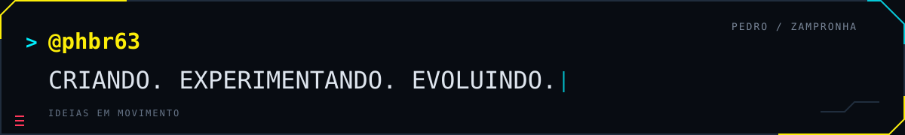

<picture>
  <source media="(max-width: 600px)" srcset="./assets/yellow-protocol/banners/banner-compacto.webp">
  
</picture>

  <b>Desenvolvimento de software · Integrações · Dados · Experiências interativas</b>

  <a href="#user-content-missões--projetos">Projetos</a> ·
  <a href="#user-content-tech-loadout--tecnologias">Tecnologias</a> ·
  <a href="#user-content-identificação--sobre-mim">Sobre mim</a> ·
  <a href="https://github.com/PHBR63?tab=repositories">Todos os repositórios</a>

Sou **Pedro Zampronha**, formado em Sistemas de Informação pela **ESPM**. Trabalho com desenvolvimento de software, integração de sistemas e dados. Gosto de conectar a necessidade de quem usa, a regra de negócio, a interface, a API e os dados.

Jogos, RPG, animes e realidade virtual também fazem parte desse percurso — e frequentemente viram projetos.

<picture>
  <source media="(prefers-reduced-motion: no-preference)" srcset="./assets/yellow-protocol/animacoes/terminal-conexao.gif">
  
</picture>

## Missões // Projetos

### 01 · 3dGame

**Jogo da turma da ESPM.** Um registro de desenvolvimento de jogos em 3D.

[Explorar o código →](https://github.com/PHBR63/3dGame)

### 02 · jogo-vr

**Unity · C#** — Projeto de jogo em realidade virtual, explorando experiências interativas.

[Explorar o código →](https://github.com/PHBR63/jogo-vr)

### 03 · Let's Roll

**React · TypeScript · Supabase** — Plataforma em desenvolvimento para RPG de mesa online, com organização de campanhas e recursos para mestres e jogadores.

[Explorar o código →](https://github.com/PHBR63/lets-roll-cursor)

**Também por aqui:** [Anime Check](https://github.com/PHBR63/anime-check), projeto voltado à organização e descoberta de animes.

Os projetos estão em diferentes estágios de desenvolvimento. As capas são ilustrações conceituais de apresentação.

## Tech loadout // Tecnologias

  
  
  
  
  
  
  
  

Tecnologias presentes na minha experiência e nos meus projetos. Escolho as ferramentas considerando o problema, a complexidade da solução e o trabalho necessário para mantê-la.

<b>Ver ferramentas por área</b>

| Área | Tecnologias e ferramentas |
| :--- | :--- |
| Back-end e integrações | Java · Spring Boot · APIs REST · Swagger · Apache Camel |
| Desenvolvimento web | JavaScript · TypeScript · React · HTML · CSS · Tailwind CSS |
| Dados e bancos | SQL · PostgreSQL · MySQL · Oracle · Supabase · Tableau |
| Automação e análise | Python |
| Jogos e realidade virtual | C# · Unity |
| Versionamento | Git · GitHub |

## Identificação // Sobre mim

<b>Minha experiência e como gosto de trabalhar</b>

Minha trajetória reúne desenvolvimento de software, integração de sistemas, análise de dados e experiência com infraestrutura e liderança técnica.

Tenho experiência com back-end em **Java e Spring Boot**, criação e documentação de APIs REST, integração entre sistemas e modernização de aplicações. Minha passagem pelo setor financeiro incluiu projetos de cobrança, atualização de tecnologias e correção de vulnerabilidades.

Também trabalho com aplicações web, automação e visualização de dados. Gosto de transformar informações dispersas em interfaces, análises e ferramentas que facilitem o trabalho e apoiem decisões.

Valorizo código legível, responsabilidades bem definidas e documentação que explique o caminho dos dados e o motivo das decisões. Procuro compreender o contexto, fazer mudanças objetivas e validar o comportamento esperado. Uso ferramentas de inteligência artificial como apoio à pesquisa e ao desenvolvimento, mantendo a revisão crítica sobre o resultado.

<picture>
  <source media="(prefers-reduced-motion: no-preference)" srcset="./assets/yellow-protocol/animacoes/divisoria-scan.gif">
  
</picture>

  <b>Continuar explorando</b> 
  <a href="https://github.com/PHBR63?tab=repositories">Repositórios</a> ·
  <a href="https://github.com/PHBR63?tab=overview">Atividade no GitHub</a>

  Identidade visual inspirada em <a href="https://www.cyberpunk.net/br/pt-br/cyberpunk-2077">Cyberpunk 2077</a>. Artes ilustradas criadas com IA.

