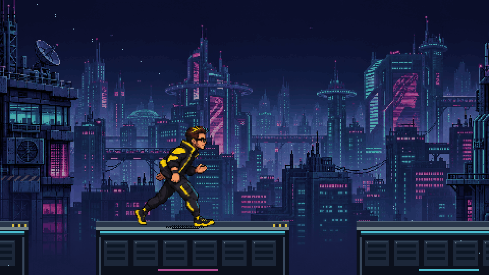

<picture><source media="(prefers-reduced-motion: reduce)" srcset="assets/midnight/hero-estatico.png?v=R05"></picture>

[Sobre mim](#sobre-mim) · [Tecnologias](#tecnologias) · [Projetos](#projetos) · [Contribuições](#contribuições) · [Contato](#contato) · [Versão sem animações](README-estatico.md)

## Sobre mim

<picture><source media="(prefers-reduced-motion: reduce)" srcset="assets/midnight/terminal-v01/perfil-terminal-estatico.png?v=terminal-v1"></picture>

<picture><source media="(prefers-reduced-motion: reduce)" srcset="assets/midnight/parkour-v02/scene-estatico.png"></picture>

## Tecnologias

<picture><source media="(prefers-reduced-motion: reduce)" srcset="assets/midnight/stack-estatico.svg?v=tech-ia-v1"></picture>

## Projetos

<picture><source media="(prefers-reduced-motion: reduce)" srcset="assets/midnight/projetos-estatico.svg?v=5"></picture>

<a href="https://github.com/institutoidex/idex-impact-hub"><picture><source media="(prefers-reduced-motion: reduce)" srcset="assets/midnight/project-scenes-v1/idex/poster.png?v=scenes-v1"></picture></a><strong><a href="https://github.com/institutoidex/idex-impact-hub">Instituto IDEX</a></strong> Site institucional com projetos, notícias, documentos de transparência e painel administrativo. <a href="https://github.com/institutoidex/idex-impact-hub">Explorar o repositório →</a>

 

<a href="https://github.com/PHBR63/anime-compass"><picture><source media="(prefers-reduced-motion: reduce)" srcset="assets/midnight/anicheck-anime-v2/poster.png?v=anime-v2"></picture></a><strong><a href="https://github.com/PHBR63/anime-compass">AniCheck</a></strong> Catálogo, descoberta, listas e acompanhamento de progresso de animes. <a href="https://github.com/PHBR63/anime-compass">Explorar o repositório →</a>

 

<a href="https://github.com/PHBR63/ficha-paranormal"><picture><source media="(prefers-reduced-motion: reduce)" srcset="assets/midnight/project-scenes-v1/letsroll/poster.png?v=scenes-v1"></picture></a><strong><a href="https://github.com/PHBR63/ficha-paranormal">Let’s Roll</a></strong> Projeto não oficial de fã para Ordem Paranormal: fichas, rolagens, campanhas e mapa tático. <a href="https://github.com/PHBR63/ficha-paranormal">Explorar o repositório →</a>

 

<a href="https://github.com/PHBR63/telahub"><picture><source media="(prefers-reduced-motion: reduce)" srcset="assets/midnight/project-scenes-v1/telahub/poster.png?v=scenes-v1"></picture></a><strong><a href="https://github.com/PHBR63/telahub">TelaHub</a></strong> Canais de comunicação, presença, câmeras e compartilhamento de tela. <a href="https://github.com/PHBR63/telahub">Explorar o repositório →</a>

 

<a href="https://github.com/PHBR63/mindforge-questforge"><picture><source media="(prefers-reduced-motion: reduce)" srcset="assets/midnight/brainpg-rpg-v2/poster.png?v=brainpg-rpg-v2"></picture></a><strong><a href="https://github.com/PHBR63/mindforge-questforge">BrainPG</a></strong> Organização de campanhas de RPG com mapas mentais e quadros de investigação. <a href="https://github.com/PHBR63/mindforge-questforge">Explorar o repositório →</a>

 

## Contribuições

## Contato

Vamos conversar sobre tecnologia e novos projetos.

 &nbsp;  &nbsp; 

 
