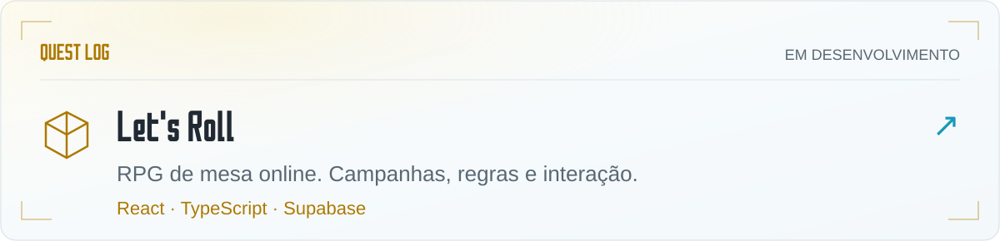
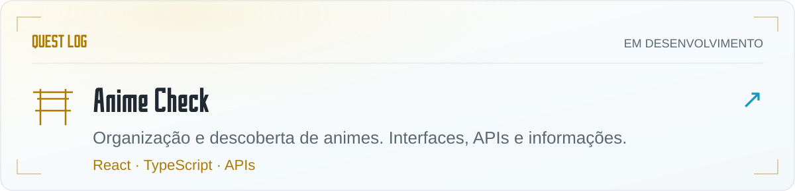
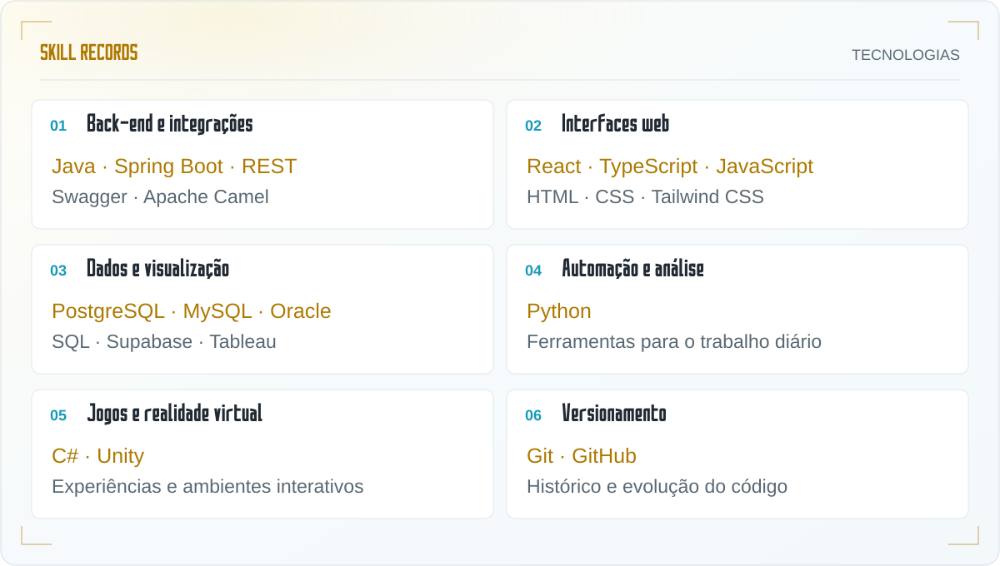
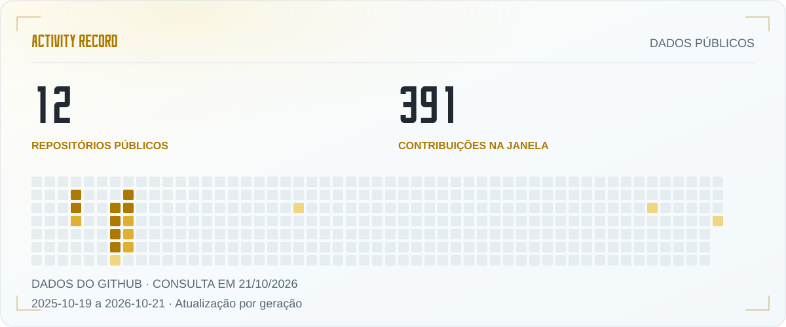

<picture><source media="(prefers-color-scheme: dark)" srcset="./assets/system-link.svg"></picture>

<b>Desenvolvimento de software · Integrações · Dados · Experiências interativas</b> Java e Spring Boot no back-end. Interfaces, dados e mundos interativos nos projetos.

<a href="#quest-log">Projetos</a> · <a href="#skill-records">Tecnologias</a> · <a href="#activity-record">Atividade</a> · <a href="#player-profile">Sobre mim</a>

<b>⚔️ Quest Log · Projetos em desenvolvimento</b>

 

<a href="https://github.com/PHBR63/lets-roll-cursor">
<picture>
  <source media="(prefers-color-scheme: dark) and (max-width: 600px)" srcset="./assets/quest-lets-roll-mobile.svg">
  <source media="(prefers-color-scheme: dark)" srcset="./assets/quest-lets-roll.svg">
  <source media="(max-width: 600px)" srcset="./assets/quest-lets-roll-light-mobile.svg">
  
</picture>
</a>

<a href="https://github.com/PHBR63/anime-check">
<picture>
  <source media="(prefers-color-scheme: dark) and (max-width: 600px)" srcset="./assets/quest-anime-check-mobile.svg">
  <source media="(prefers-color-scheme: dark)" srcset="./assets/quest-anime-check.svg">
  <source media="(max-width: 600px)" srcset="./assets/quest-anime-check-light-mobile.svg">
  
</picture>
</a>

Projetos em desenvolvimento e experimentações, com diferentes estágios de maturidade.

<b>🗡️ Skill Records · Tecnologias e ferramentas</b>

 

<picture>
  <source media="(prefers-color-scheme: dark) and (max-width: 600px)" srcset="./assets/skill-records-mobile.svg">
  <source media="(prefers-color-scheme: dark)" srcset="./assets/skill-records.svg">
  <source media="(max-width: 600px)" srcset="./assets/skill-records-light-mobile.svg">
  
</picture>

Escolho as ferramentas de acordo com o problema, considerando a complexidade da solução e o trabalho necessário para mantê-la.

<b>💠 Activity Record · Atividade no GitHub</b>

 

<picture>
  <source media="(prefers-color-scheme: dark) and (max-width: 600px)" srcset="./assets/activity-record-mobile.svg">
  <source media="(prefers-color-scheme: dark)" srcset="./assets/activity-record.svg">
  <source media="(max-width: 600px)" srcset="./assets/activity-record-light-mobile.svg">
  
</picture>

Fotografia dos dados públicos consultados em 21/10/2026; não é um indicador em tempo real.

<b>👤 Player Profile · Minha trajetória, experiência e forma de trabalhar</b>

 

# Olá, sou Pedro Zampronha 👋

**Desenvolvimento de software · Integrações · Dados · Experiências interativas**

## Sobre mim

Sou profissional de tecnologia, formado em Sistemas de Informação pela ESPM. Minha trajetória reúne desenvolvimento de software, integração de sistemas, análise de dados e experiência com infraestrutura e liderança técnica.

Gosto de entender como as coisas se conectam: a necessidade de quem usa, a regra de negócio, a interface, a API e os dados. Esse olhar orienta meu trabalho na criação de soluções úteis, organizadas e que possam continuar evoluindo.

## Minha experiência

Tenho experiência com desenvolvimento back-end em **Java e Spring Boot**, criação e documentação de APIs REST, integração entre sistemas e modernização de aplicações.

Minha passagem pelo setor financeiro incluiu projetos de cobrança, atualização de tecnologias e correção de vulnerabilidades. Essa experiência reforçou meu cuidado com manutenção, segurança e clareza nas decisões técnicas.

Também trabalho com aplicações web, automação e visualização de dados. Gosto de transformar informações dispersas em interfaces, análises e ferramentas que facilitem o trabalho e apoiem decisões.

## Tecnologias e ferramentas

| Área | Tecnologias e ferramentas |
| :--- | :--- |
| Back-end e integrações | Java · Spring Boot · APIs REST · Swagger · Apache Camel |
| Desenvolvimento web | JavaScript · TypeScript · React · HTML · CSS · Tailwind CSS |
| Dados e bancos | SQL · PostgreSQL · MySQL · Oracle · Supabase · Tableau |
| Automação e análise | Python |
| Jogos e realidade virtual | C# · Unity |
| Versionamento | Git · GitHub |

Escolho as ferramentas de acordo com o problema, considerando a complexidade da solução e o trabalho necessário para mantê-la.

## Projetos

### 🎲 Let's Roll

Projeto de plataforma para RPG de mesa online, com foco na organização de campanhas e na experiência de mestres e jogadores. É um espaço para desenvolver interfaces, modelar regras e explorar recursos de interação.

[Explorar o repositório →](https://github.com/PHBR63/lets-roll-cursor)

### 🎌 Anime Check

Aplicação voltada à organização e descoberta de animes. Reúne meu interesse por esse universo com desenvolvimento web, integração com APIs e apresentação de informações.

[Explorar o repositório →](https://github.com/PHBR63/anime-check)

Estes repositórios incluem projetos em desenvolvimento e experimentações, com diferentes estágios de maturidade.

## Como gosto de trabalhar

Valorizo código legível, responsabilidades bem definidas e documentação que ajude outro desenvolvedor a entender o caminho dos dados e o motivo das decisões.

Procuro compreender o contexto antes de alterar uma solução, fazer mudanças objetivas e validar o comportamento esperado. Uso ferramentas de inteligência artificial como apoio à pesquisa e ao desenvolvimento, mantendo a revisão crítica sobre o resultado.

## Além do trabalho

Jogos, RPG, animes e realidade virtual também fazem parte dos meus interesses — e frequentemente viram projetos. Gosto de explorar como programação, narrativa e interação podem se encontrar em uma mesma experiência.

Por aqui, compartilho parte desse percurso: aplicações, estudos e ideias que ganham forma em código.

 <b>O próximo projeto começa com uma boa ideia.</b> Software, RPG, animes e realidade virtual fazem parte do caminho.  <a href="https://github.com/PHBR63?tab=repositories">Explorar meus repositórios</a>

PHBR63 · Inspirado em Sword Art Online / Aincrad · Sem vínculo oficial. Referências: <a href="https://aincrad-archive.hecate2.chatgpt.site/">Aincrad Memory Archive</a> · <a href="https://wallpapersafari.com/w/F8j0Gb">Wallpaper de Aincrad</a>. Arte do cabeçalho adaptada com IA.

