

<picture>
  <source media="(max-width: 600px)" srcset="./assets/yellow-protocol/banners/banner-compacto.webp">
  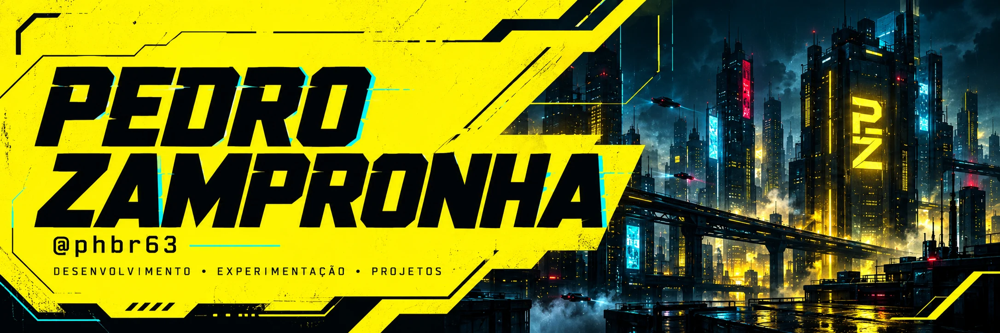
</picture>

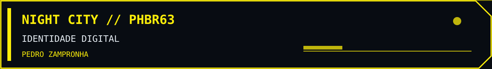

<picture>
  <source media="(max-width: 600px)" srcset="./assets/neon-protocol/intro-mobile.svg">
  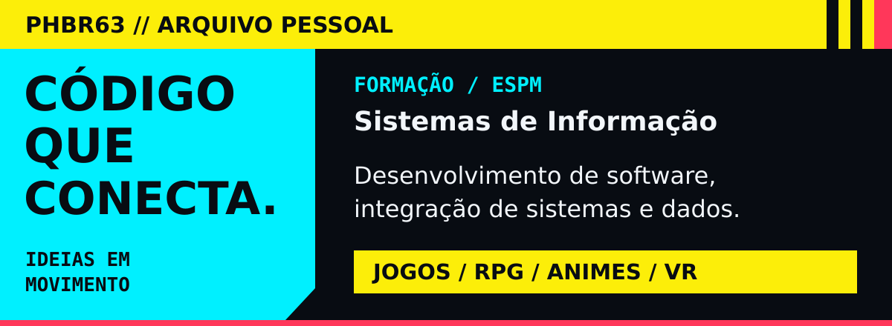
</picture>

<picture>
  <source media="(max-width: 600px) and (prefers-reduced-motion: reduce)" srcset="./assets/neon-protocol/terminal-mobile.svg">
  <source media="(prefers-reduced-motion: reduce)" srcset="./assets/yellow-protocol/animacoes/terminal-conexao.png">
  <source media="(max-width: 600px)" srcset="./assets/neon-protocol/terminal-mobile.gif">
  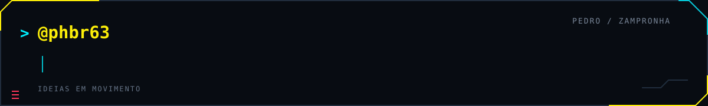
</picture>

<picture>
  <source media="(prefers-reduced-motion: reduce)" srcset="./assets/yellow-protocol/animacoes/divisoria-scan.png">
  
</picture>

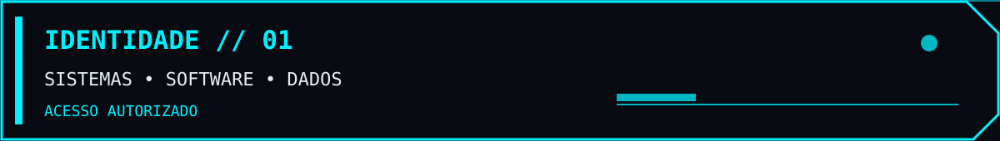

<picture>
  <source media="(max-width: 600px)" srcset="./assets/neon-protocol/stack-mobile.svg">
  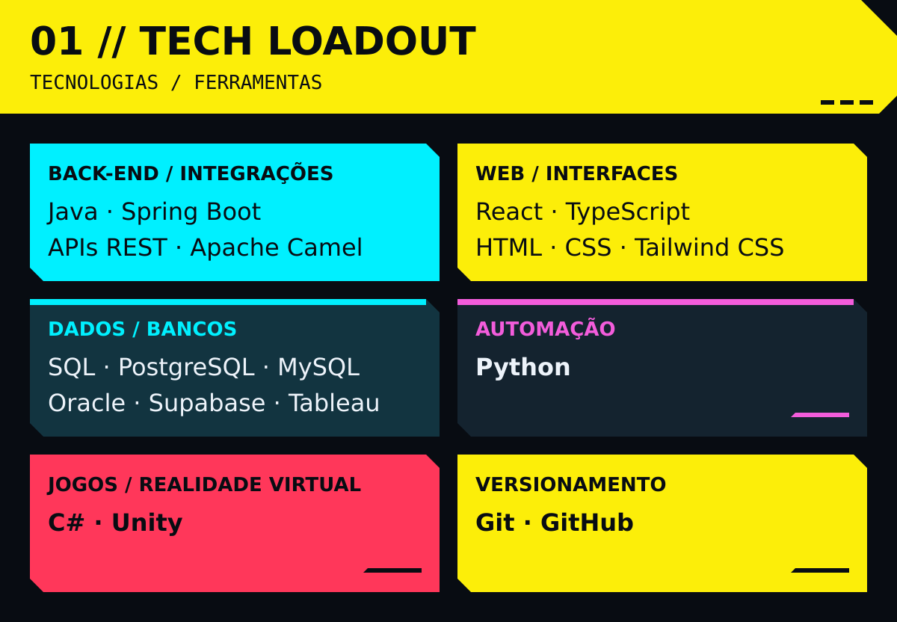
</picture>

<picture>
  <source media="(prefers-reduced-motion: reduce)" srcset="./assets/yellow-protocol/animacoes/divisoria-scan.png">
  
</picture>

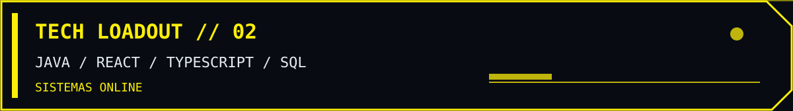

<picture>
  <source media="(max-width: 600px)" srcset="./assets/neon-protocol/section-projects-mobile.svg">
  
</picture>

<b>Projetos principais</b> Uma seleção de produtos, ferramentas e experiências construídas em diferentes domínios.

  <a href="https://github.com/institutoidex/idex-impact-hub">
    <picture>
      <source media="(max-width: 600px)" srcset="./assets/neon-protocol/project-idex-impact-hub-mobile.svg">
      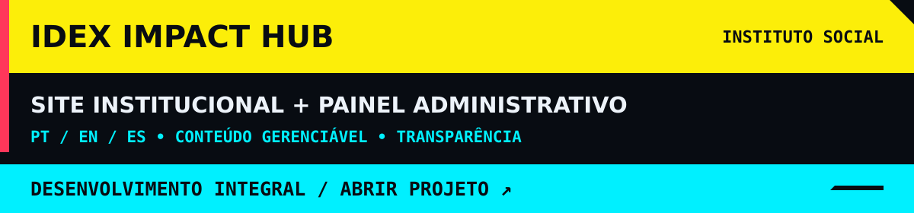
    </picture>
  </a>

<a href="https://github.com/institutoidex/idex-impact-hub"><b>01 · Instituto IDEX — Impact Hub</b></a> Desenvolvimento integral do site institucional e painel administrativo do Instituto IDEX. Site em português, inglês e espanhol, com projetos, notícias, transparência e contato gerenciados pela equipe. React 19 · TypeScript · TanStack Start · Supabase · Tailwind CSS <a href="https://institutoidex.org">Site publicado →</a>

<a href="https://github.com/PHBR63/anime-compass"><b>02 · AniCheck</b></a> Catálogo e descoberta de animes, listas pessoais, progresso, comunidade e experiência instalável com recursos offline. React 18 · TypeScript · Vite · Tailwind CSS · PWA · Lovable Cloud

<a href="https://github.com/PHBR63/ficha-paranormal"><b>03 · Let's Roll</b></a> Mesa virtual de fã, não oficial, para Ordem Paranormal RPG: fichas, rolagens, combate, campanhas e mapa tático colaborativo. React 19 · TypeScript · Vite · Supabase · PWA

<a href="https://github.com/PHBR63/telahub"><b>04 · TelaHub</b></a> Comunicação de equipes com comunidades, canais persistentes, presença em tempo real, câmeras e compartilhamento de tela por LiveKit/WebRTC. React · Socket.IO · SQLite · LiveKit · Docker

<a href="https://github.com/PHBR63/RyuuImob-dev"><b>05 · RyuuImob</b></a> Demonstração funcional de portal imobiliário e painel de gestão. Trabalha com dados de exemplo e armazenamento local no navegador, sem banco compartilhado ou autenticação segura no servidor. React 18 · TypeScript · Vite · Zustand

<a href="https://github.com/PHBR63/mindforge-questforge"><b>06 · BrainPG</b></a> Organização de campanhas de RPG com mapa mental, quadro de investigação, NPCs, locais, facções, missões, sessões e biblioteca de arquivos. React · TypeScript · React Flow · Lovable Cloud

Os resumos refletem os READMEs consultados em 26/10/2026. Let's Roll é um projeto de fã não oficial; RyuuImob está descrito no próprio README como demonstração local.

<b>Galeria visual de outros projetos</b>

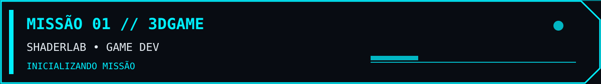

<a href="https://github.com/PHBR63/3dGame">
  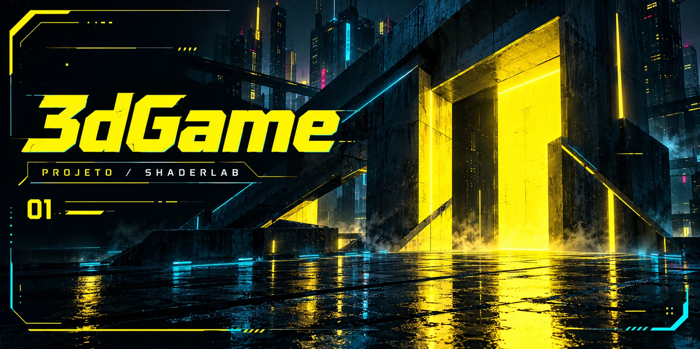
  <picture>
  <source media="(max-width: 600px)" srcset="./assets/neon-protocol/project-3dgame-mobile.svg">
  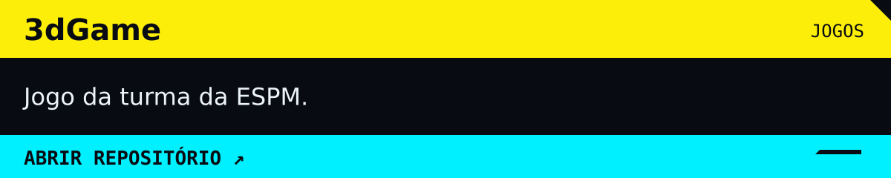
</picture>
</a>

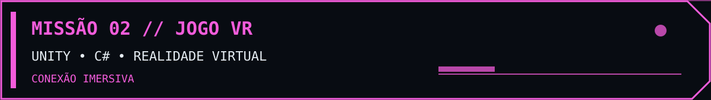

<a href="https://github.com/PHBR63/jogo-vr">
  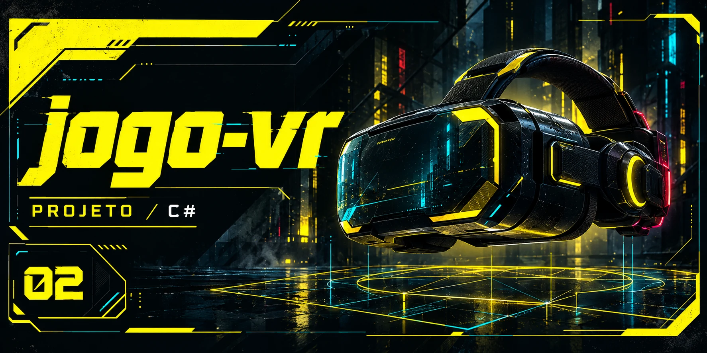
  <picture>
  <source media="(max-width: 600px)" srcset="./assets/neon-protocol/project-vr-mobile.svg">
  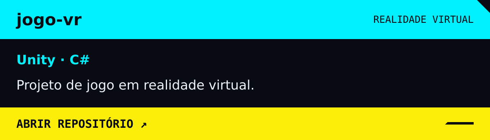
</picture>
</a>

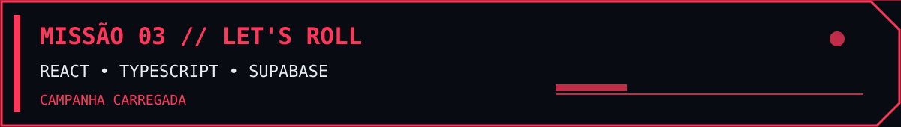

<a href="https://github.com/PHBR63/lets-roll-cursor">
  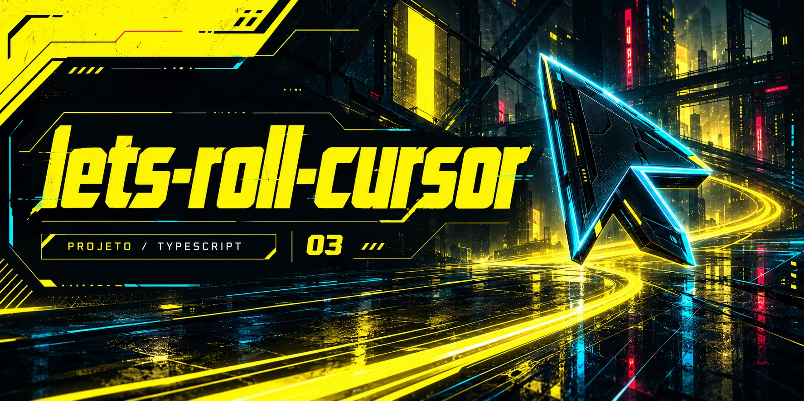
  <picture>
  <source media="(max-width: 600px)" srcset="./assets/neon-protocol/project-roll-mobile.svg">
  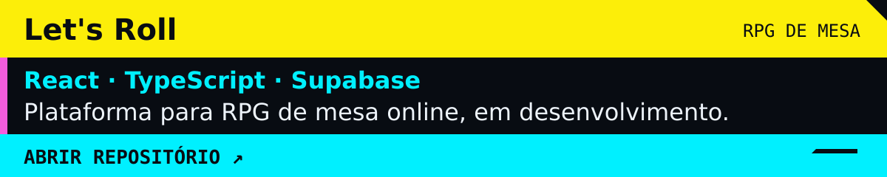
</picture>
</a>

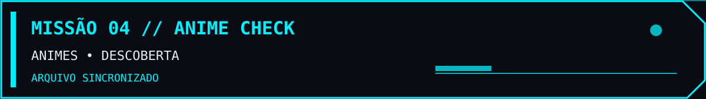

<a href="https://github.com/PHBR63/anime-check">
  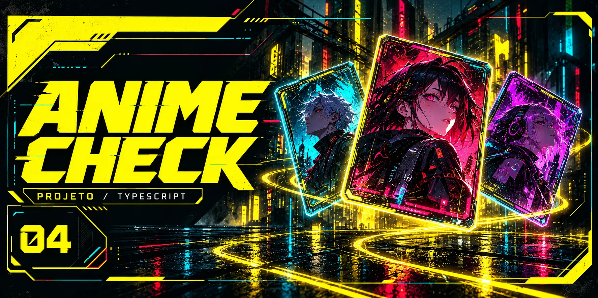
  <picture>
  <source media="(max-width: 600px)" srcset="./assets/neon-protocol/project-anime-mobile.svg">
  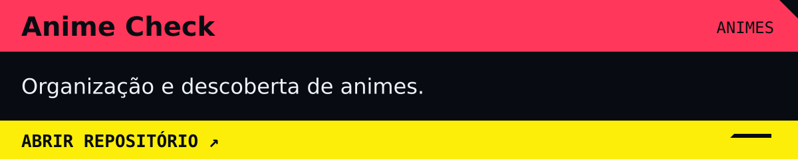
</picture>
</a>

<picture>
  <source media="(prefers-reduced-motion: reduce)" srcset="./assets/yellow-protocol/animacoes/divisoria-scan.png">
  
</picture>

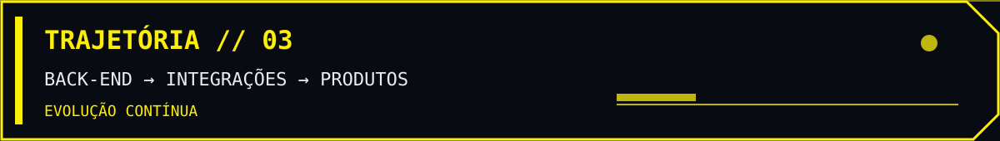

<picture>
  <source media="(max-width: 600px)" srcset="./assets/neon-protocol/about-mobile.svg">
  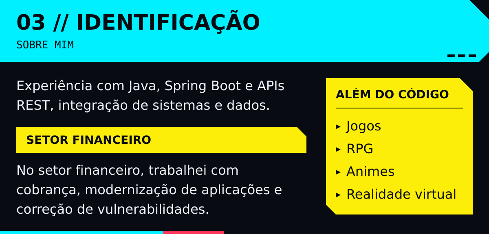
</picture>

<picture>
  <source media="(prefers-reduced-motion: reduce)" srcset="./assets/yellow-protocol/animacoes/divisoria-scan.png">
  
</picture>

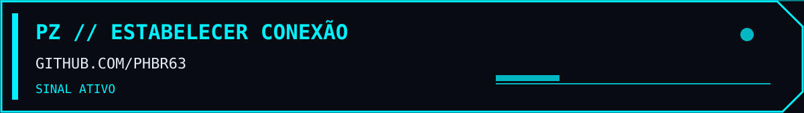

<a href="https://github.com/PHBR63?tab=repositories">
<picture>
  <source media="(max-width: 600px)" srcset="./assets/neon-protocol/footer-mobile.svg">
  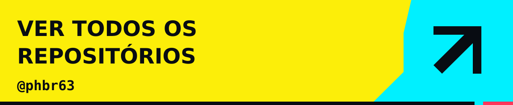
</picture>
</a>

<b>Ler perfil em texto — apresentação, tecnologias e projetos</b>

## Pedro Zampronha

Sou **Pedro Zampronha**, formado em Sistemas de Informação pela **ESPM**. Trabalho com desenvolvimento de software, integração de sistemas e dados. Gosto de conectar a necessidade de quem usa, a regra de negócio, a interface, a API e os dados.

Jogos, RPG, animes e realidade virtual também fazem parte desse percurso — e frequentemente viram projetos.

### Tecnologias e ferramentas

Tecnologias presentes na minha experiência e nos meus projetos. Escolho as ferramentas considerando o problema, a complexidade da solução e o trabalho necessário para mantê-la.

| Área | Tecnologias e ferramentas |
| :--- | :--- |
| Back-end e integrações | Java · Spring Boot · APIs REST · Swagger · Apache Camel |
| Desenvolvimento web | JavaScript · TypeScript · React · HTML · CSS · Tailwind CSS |
| Dados e bancos | SQL · PostgreSQL · MySQL · Oracle · Supabase · Tableau |
| Automação e análise | Python |
| Jogos e realidade virtual | C# · Unity |
| Versionamento | Git · GitHub |

### Projetos em destaque

#### 01 · Instituto IDEX — Impact Hub

Desenvolvimento integral do site institucional e painel administrativo do Instituto IDEX. Site em português, inglês e espanhol, com projetos, notícias, transparência e contato gerenciados pela equipe.

[Repositório no GitHub →](https://github.com/institutoidex/idex-impact-hub) · [Site publicado →](https://institutoidex.org)

React 19 · TypeScript · TanStack Start · Supabase · Tailwind CSS

#### 02 · AniCheck

Catálogo e descoberta de animes, listas pessoais, progresso, comunidade e recursos PWA com suporte offline.

[Explorar anime-compass →](https://github.com/PHBR63/anime-compass)

#### 03 · Let's Roll

Mesa virtual de fã, não oficial, para Ordem Paranormal RPG. Reúne fichas automatizadas, rolagens, combate, campanhas e mapa tático colaborativo.

[Explorar ficha-paranormal →](https://github.com/PHBR63/ficha-paranormal)

#### 04 · TelaHub

Aplicativo instalável para comunicação em equipes, com comunidades, canais persistentes, presença em tempo real e salas de compartilhamento de tela e câmeras via LiveKit/WebRTC.

[Explorar telahub →](https://github.com/PHBR63/telahub)

#### 05 · RyuuImob

Demonstração funcional de portal imobiliário e painel de gestão. O README informa que imóveis e artigos são dados de exemplo e que as alterações ficam apenas no navegador; não há banco compartilhado nem autenticação segura no servidor.

[Explorar RyuuImob-dev →](https://github.com/PHBR63/RyuuImob-dev)

#### 06 · BrainPG

Ferramenta para Mestres de RPG organizarem campanhas, personagens, lugares, facções, missões, sessões, mapas mentais e investigações.

[Explorar mindforge-questforge →](https://github.com/PHBR63/mindforge-questforge)

Os nomes e resumos seguem os READMEs atuais. As capas existentes na galeria visual são ilustrações conceituais de outros repositórios.

### Experiência e forma de trabalhar

Minha trajetória reúne desenvolvimento de software, integração de sistemas, análise de dados e experiência com infraestrutura e liderança técnica.

Tenho experiência com back-end em **Java e Spring Boot**, criação e documentação de APIs REST, integração entre sistemas e modernização de aplicações. Minha passagem pelo setor financeiro incluiu projetos de cobrança, atualização de tecnologias e correção de vulnerabilidades.

Também trabalho com aplicações web, automação e visualização de dados. Gosto de transformar informações dispersas em interfaces, análises e ferramentas que facilitem o trabalho e apoiem decisões.

Valorizo código legível, responsabilidades bem definidas e documentação que explique o caminho dos dados e o motivo das decisões. Procuro compreender o contexto, fazer mudanças objetivas e validar o comportamento esperado. Uso ferramentas de inteligência artificial como apoio à pesquisa e ao desenvolvimento, mantendo a revisão crítica sobre o resultado.

[Todos os repositórios](https://github.com/PHBR63?tab=repositories) · [Atividade no GitHub](https://github.com/PHBR63?tab=overview)

  Identidade visual inspirada em <a href="https://www.cyberpunk.net/br/pt-br/cyberpunk-2077">Cyberpunk 2077</a>. Capas conceituais criadas com IA.

